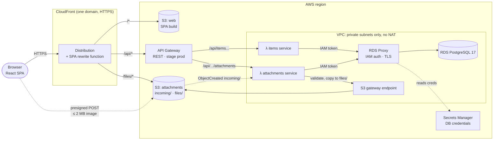
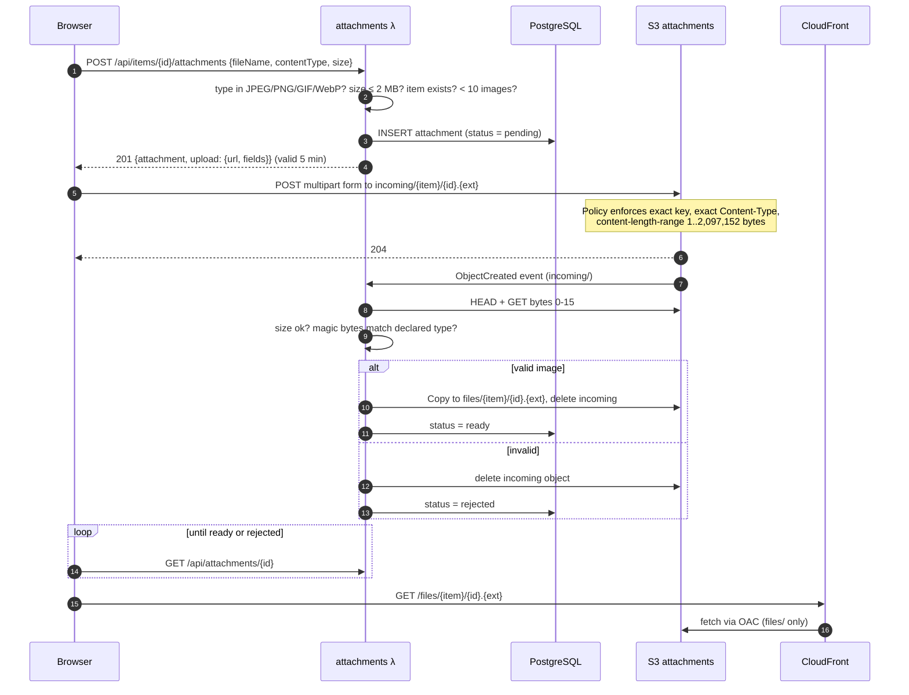
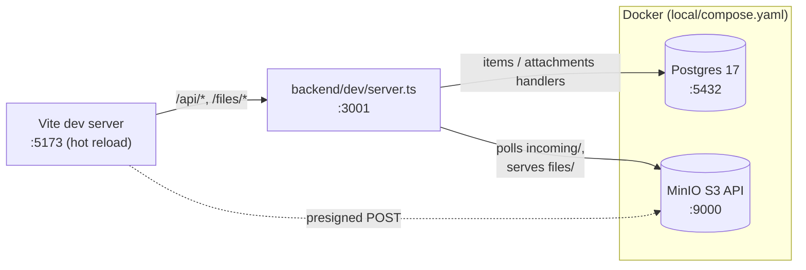
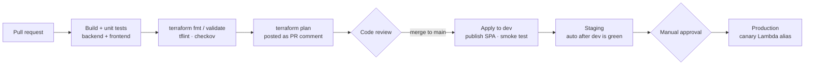

# Serverless CRUD on AWS (Terraform)

> [!IMPORTANT]
> **This is a demo project.** It shows how quickly you can scaffold a full-stack serverless app and provision the AWS resources it needs. It is not a production-ready product: see the [Production checklist](#production-checklist) before using it for anything real.
>
> The main idea is that the whole stack is easy to **set up, deploy and destroy** when you need it, one script per step:
>
> | Step | Command | What it does |
> |------|---------|--------------|
> | Run locally | `./scripts/dev.sh` | Whole app on your machine with Docker, no AWS account |
> | Check | `./scripts/check.sh` | Tests, builds, Terraform validate and offline plan tests |
> | Deploy | `./scripts/deploy.sh <stack>` | Builds everything, provisions one stack in AWS with Terraform, publishes the SPA |
> | Destroy | `./scripts/destroy.sh <stack>` | Empties buckets and removes every AWS resource of that stack |
>
> Deployed resources cost money while they exist (mostly RDS), so destroy the stack when you're done. See [Cost](#cost-dev-defaults-rough).

A full-stack serverless scaffold: a React SPA on S3 + CloudFront, a REST API on API Gateway, two Lambda services (**items** and **attachments**) and PostgreSQL on RDS behind RDS Proxy. Items can carry image attachments (JPEG, PNG, GIF or WebP, 2 MB max) that are uploaded directly to S3 and served through CloudFront.

- [Architecture](#architecture)
- [Image upload flow](#image-upload-flow)
- [Repository layout](#repository-layout)
- [Local development (no AWS account)](#local-development-no-aws-account)
- [Deploy from your machine](#deploy-from-your-machine)
- [Day-to-day changes](#day-to-day-changes)
- [Managing stacks: deploy a new one, destroy one](#managing-stacks)
- [Troubleshooting](#troubleshooting)
- [CI/CD roadmap](#cicd-roadmap)
- [Production checklist](#production-checklist)

## Architecture



| Path | Served by | Caching |
|------|-----------|---------|
| `/*` | S3 web bucket via Origin Access Control | Managed-CachingOptimized, SPA deep links rewritten to `/index.html` |
| `/api/*` | API Gateway → Lambda | Disabled |
| `/files/*` | S3 attachments bucket (`files/` prefix only) | Optimized; keys are immutable UUIDs |

### Services

| Service | Lambda | Routes |
|---------|--------|--------|
| items | `<project>-<env>-items` | `GET/POST /api/items`, `GET/PUT/DELETE /api/items/{id}` |
| attachments | `<project>-<env>-attachments` | `GET/POST /api/items/{id}/attachments`, `GET/DELETE /api/attachments/{attachmentId}`, plus the S3 `ObjectCreated` trigger |

Each service has its own IAM role (least privilege) and its own zip, built from `backend/src/functions/<service>/`. Both share `backend/src/shared/` (DB pool, schema, HTTP helpers, image rules) and the same VPC, RDS Proxy and database.

## Image upload flow

File bytes never pass through API Gateway or Lambda: the browser uploads straight to S3, and S3 itself enforces the rules signed into the upload policy.



Why this shape:

- **Three layers of the 2 MB / image-only rule.** The UI checks first for fast feedback, S3 rejects anything outside the signed policy, and the validator checks real file signatures so a renamed `.exe` never gets published.
- **SVG is not allowed.** SVG can carry script; raster formats cannot.
- **Nothing unvalidated is ever served.** CloudFront can read only `files/`. Anything left in `incoming/` expires after one day through a lifecycle rule.
- **Still no NAT gateway.** Lambda reaches S3 through a free gateway endpoint. Presigned POSTs are signed locally, with no network call.

## Repository layout

```
infra/
  versions.tf         Terraform/provider versions, default tags, optional S3 backend
  variables.tf        All inputs with defaults
  network.tf          VPC, private subnets, security groups
  database.tf         RDS PostgreSQL, Secrets Manager, RDS Proxy
  services.tf         items + attachments Lambda services and their triggers
  attachments.tf      Attachments bucket, CORS, lifecycle, S3 gateway endpoint
  api.tf              API Gateway REST resources, methods, stage
  frontend.tf         Web bucket, CloudFront (3 origins), SPA rewrite function
  outputs.tf
  modules/lambda-service/   zip + IAM role + log group + VPC Lambda
  tests/offline.tftest.hcl  `terraform test` with mocked providers (no AWS needed)
backend/
  src/functions/items/         items service: index.ts (handler + routes), validation.ts, repository.ts (SQL)
  src/functions/attachments/   attachments service: index.ts (API vs S3 dispatch), api.ts, upload-processor.ts,
                               storage.ts (S3), repository.ts (SQL), config.ts, dto.ts
  src/shared/           DB pool (IAM auth in AWS, password locally), schema, image rules, HTTP helpers, types
  dev/server.ts         local API Gateway + /files + S3-event emulator running the real handlers
  dev/local.env         local settings
  test/                 unit tests (node --test, TypeScript via tsx)
  scripts/build.ts      tsc (1:1, unminified ESM) + prod node_modules -> dist/<service>/
frontend/               Vite + React 19 + TypeScript SPA (relative /api and /files URLs)
  src/api/              typed fetch wrappers (items, attachments + direct-to-S3 upload)
  src/components/       ItemForm, ItemList, Attachments
local/compose.yaml      Postgres 17 + MinIO (S3 emulator) for local development
scripts/dev.sh          run everything locally
scripts/check.sh        all offline checks: tests, builds, terraform fmt/validate/test, linters
scripts/deploy.sh       <stack>: build → terraform apply → upload SPA → invalidate
scripts/destroy.sh      <stack>: empty buckets → terraform destroy → clean leftovers
infra/stacks/           one <project>-<environment>.tfvars per deployed stack (not committed)
infra/stack.tf          guard: a stack's state can't be renamed into another stack
.github/workflows/ci-cd.yml.example   starter pipeline (see roadmap)
```

## Local development (no AWS account)

Build and test the whole app on your machine before creating any cloud resources. The Lambda handlers run unchanged; only the services around them are swapped for local stand-ins.



| In AWS | Locally | Notes |
|--------|---------|-------|
| CloudFront `/api/*`, `/files/*` | Vite proxy → dev server | Same relative URLs in the frontend |
| API Gateway (AWS_PROXY) | `backend/dev/server.ts` | Same routes and event shape as `infra/api.tf` |
| Lambda | Same handler code, in-process (TypeScript via `tsx`) | Restarts on file changes (`node --watch`) |
| RDS Proxy + IAM auth | Direct connection with `DB_PASSWORD` | Only when `DB_PASSWORD` is set |
| S3 + presigned POST | MinIO | Enforces the same POST policy (2 MB, exact Content-Type) |
| S3 `ObjectCreated` trigger | Dev server polls `incoming/` every second | Same event shape the handler gets from S3 |

### Prerequisites

- Node.js 22
- Docker Desktop (or Docker Engine with the Compose plugin)
- Terraform ≥ 1.11, only for the infrastructure checks

### Run the app

```bash
./scripts/dev.sh
```

Open http://localhost:5173. The script starts Postgres and MinIO in Docker, installs dependencies on first run, starts the API dev server on :3001 and Vite on :5173. Tables are created on the first request.

Useful extras:

- API directly: `curl -s localhost:3001/api/items`
- Stored files: MinIO console at http://localhost:9001 (user `localdev`, password `localdev-secret`)

The passwords and keys in `local/compose.yaml` and `backend/dev/local.env` are **not real secrets**. They are fixed placeholders for local containers bound to `127.0.0.1`, and they are committed on purpose so the app runs without any setup. Real credentials never go in these files. In AWS, the DB password is generated by Terraform and Lambda uses IAM roles, not access keys.
- Database: `docker compose -f local/compose.yaml exec postgres psql -U app_admin app`
- Stop containers: `docker compose -f local/compose.yaml down` (add `-v` to wipe data)

Try the attachment rules: upload a 3 MB photo (blocked in the browser; with the check bypassed, MinIO rejects it with HTTP 400), or rename a PDF to `.png` (the upload succeeds, then the validator deletes it and the UI reports it isn't a valid image).

### Run the checks

```bash
./scripts/check.sh
```

| Check | What it proves |
|-------|----------------|
| `npm run typecheck` (backend, frontend) | TypeScript compiles in strict mode |
| `npm test` (backend) | Image type allowlist, 2 MB boundary, file-signature detection |
| `npm run build` (backend, frontend) | Both Lambda packages and the SPA build |
| `terraform fmt -check`, `terraform validate` | HCL is formatted, references and types are valid |
| `terraform test` | Plans the full stack against mocked AWS providers and asserts the rules: private DB, TLS proxy, 9 routes, locked-down buckets, POST-only CORS, prod hardening flags |
| `tflint`, `trivy config` (if installed) | Provider-specific lint and security misconfigurations (trivy reports; decide per finding) |

`terraform test` needs no credentials: `infra/tests/offline.tftest.hcl` mocks the AWS and archive providers. A real `terraform plan` does need AWS credentials, because it reads your account, region and availability zones.

### What local mode doesn't cover

Verify these on the first real deploy: IAM policies and IAM database auth, RDS Proxy behavior, CloudFront routing and caching, VPC networking and security groups, and real S3 event timing. Keep the dev stack small and short-lived (`./scripts/destroy.sh`) and it stays cheap.

## Deploy from your machine

### 1. Install the tools

| Tool | Version | Check |
|------|---------|-------|
| Terraform | ≥ 1.11 (write-only arguments) | `terraform version` |
| Node.js | 22 | `node -v` |
| AWS CLI | v2 | `aws --version` |
| Bash | any (macOS, Linux, WSL or Git Bash on Windows) | |

macOS: `brew install hashicorp/tap/terraform node@22 awscli`. Windows: use WSL2 and the Linux instructions.

### 2. Sign in to AWS

Use IAM Identity Center (SSO) instead of long-lived access keys, and never the root user.

1. In the AWS console, open **IAM Identity Center**, enable it, create a user for yourself and assign it to your account with the `AdministratorAccess` permission set. The stack creates IAM roles, so `PowerUserAccess` is not enough.
2. Configure the CLI profile and sign in:

```bash
aws configure sso                 # name the profile e.g. "crud-dev", region ca-central-1
aws sso login --profile crud-dev
export AWS_PROFILE=crud-dev
aws sts get-caller-identity       # should print your account ID
```

3. Recommended: in **Billing → Budgets**, create a monthly cost budget with an email alert.

### 3. Configure a stack

A **stack** is one deployed instance of the app, named `<project>-<environment>` (for example `crud-app-dev`). You can run as many stacks as you like side by side, in the same account or not. Each stack has:

- its settings: `infra/stacks/<stack>.tfvars`
- its own Terraform state: a workspace with the same name (`infra/terraform.tfstate.d/<stack>/` with local state)
- its own resources: VPC, database, buckets, Lambdas, API, CloudFront, all prefixed with the stack name

```bash
cp infra/stacks/example.tfvars.example infra/stacks/crud-app-dev.tfvars
```

Set `project`, `environment` (they must match the file name) and `aws_region`. Every other variable in `infra/variables.tf` has a working default.

Never change `project` or `environment` of a stack that's already deployed: every resource name depends on them, so Terraform would replace the whole stack. `infra/stack.tf` stops the plan if you try. For a new instance, add a new file and deploy that name; existing stacks are untouched. See [Managing stacks](#managing-stacks) for deploying more stacks and destroying them.

Optional but recommended: turn on remote state before the first apply. Create an S3 bucket for state once:

```bash
aws s3api create-bucket --bucket <your-tf-state-bucket> --region ca-central-1 \
  --create-bucket-configuration LocationConstraint=ca-central-1
aws s3api put-bucket-versioning --bucket <your-tf-state-bucket> \
  --versioning-configuration Status=Enabled
```

Then uncomment the `backend "s3"` block in `infra/versions.tf` and set the bucket name. Workspaces keep working: the S3 backend stores each stack's state under `env:/<stack>/<key>`. Local state works for a solo sandbox, but CI/CD needs remote state.

### 4. Deploy

Run `./scripts/check.sh` first; it catches most mistakes before anything is created.

```bash
./scripts/deploy.sh crud-app-dev                 # review the plan, type "yes"
# or: ./scripts/deploy.sh crud-app-dev -auto-approve
./scripts/deploy.sh                              # no name: lists the stacks in infra/stacks/
```

What happens:

1. `backend/` installs and builds both services into `backend/dist/items/` and `backend/dist/attachments/`: `tsc` transpiles `src/` file by file into readable, unminified ES modules (same folder layout, comments kept), and production `node_modules` (pg, AWS SDK) are copied next to them. What you see in the Lambda console matches `src/` line for line in structure.
2. `terraform apply` creates about 60 resources. The first run takes around 15 minutes, mostly RDS, RDS Proxy and CloudFront.
3. `frontend/` builds, uploads to the web bucket, and CloudFront invalidates `index.html`.
4. The app URL is printed at the end.

The first `npm install` creates `package-lock.json` files. Commit them so later installs (and CI) use `npm ci`.

### 5. Verify

```bash
cd infra
export TF_WORKSPACE=crud-app-dev   # which stack's outputs to read
APP=$(terraform output -raw app_url)

curl -s -X POST "$APP/api/items" -H 'Content-Type: application/json' \
  -d '{"name":"First item","description":"hello"}'
curl -s "$APP/api/items"
```

Open the app URL, add an item, click **Images** and upload a picture. It appears within a second or two once validation finishes.

Logs:

```bash
aws logs tail /aws/lambda/crud-app-dev-items --follow
aws logs tail /aws/lambda/crud-app-dev-attachments --follow
```

### 6. Run the frontend locally against the deployed API

```bash
cd frontend
VITE_API_ORIGIN=$(TF_WORKSPACE=crud-app-dev terraform -chdir=../infra output -raw app_url) npm run dev
```

Vite proxies `/api` and `/files` to CloudFront. Direct uploads from `http://localhost:5173` are allowed by the bucket CORS rule (`extra_upload_origins`).

## Day-to-day changes

| You changed | Run | Time |
|-------------|-----|------|
| Lambda code (`backend/src`) | `./scripts/deploy.sh <stack>` (Terraform sees the new zip hash and updates only the function) | ~1 min |
| Frontend (`frontend/src`) | `./scripts/deploy.sh <stack>`, or build + `aws s3 sync` + invalidation only | ~1 min |
| Infrastructure (`infra/`) | `./scripts/deploy.sh <stack>` for each stack, and read the plan carefully | varies |
| DB password rotation | bump `db_password_version` in the stack's tfvars, deploy | ~2 min |

## Managing stacks

A stack is one deployed instance of the app. Its name is `<project>-<environment>`, and each stack has its own settings file, Terraform state and AWS resources (see [3. Configure a stack](#3-configure-a-stack)). Every command takes the stack name, and nothing you do to one stack touches another.

| Task | Command |
|------|---------|
| List stacks | `./scripts/deploy.sh` (no name) |
| Deploy a new stack | create `infra/stacks/<stack>.tfvars`, then `./scripts/deploy.sh <stack>` |
| Update an existing stack | `./scripts/deploy.sh <stack>` |
| Destroy a stack | `./scripts/destroy.sh <stack>` |

### Deploy a new stack

1. Pick a name: `<project>-<environment>`, lowercase letters, digits and hyphens, for example `crud-demo-dev`. Resource names such as bucket names are built from it, so keep it short.
2. Create its settings file. The file name **is** the stack name, and `project` and `environment` inside it must match that name:

   ```bash
   cp infra/stacks/example.tfvars.example infra/stacks/crud-demo-dev.tfvars
   ```

   ```hcl
   # infra/stacks/crud-demo-dev.tfvars
   project     = "crud-demo"
   environment = "dev"
   aws_region  = "ca-central-1"

   # On an AWS free plan account also set:
   # db_proxy_enabled         = false
   # db_backup_retention_days = 1
   ```

3. Deploy:

   ```bash
   ./scripts/deploy.sh crud-demo-dev             # review the plan, type "yes"
   ```

   On the first run the script creates a Terraform workspace named `crud-demo-dev` for the stack's state. The plan should only **create** resources (about 60). If it wants to change or destroy anything, stop: you are pointing at another stack's state.

4. The last line prints the app URL. The first deploy takes about 15 minutes.

To read a stack's outputs later, name its workspace:

```bash
TF_WORKSPACE=crud-demo-dev terraform -chdir=infra output app_url
```

Each stack is a full copy: its own VPC, RDS instance, buckets, Lambdas, API and CloudFront distribution, so each one adds the [cost](#cost-dev-defaults-rough) of a whole stack. The default AWS quota is 5 VPCs per region.

**Don't rename a deployed stack.** Changing `project` or `environment` in an existing file would make Terraform replace every resource. The guard in `infra/stack.tf` stops the plan with `Workspace "..." holds the state of stack "..."`. To move to a new name, deploy a new stack under that name and destroy the old one.

### Update an existing stack

```bash
./scripts/deploy.sh crud-demo-dev
```

This rebuilds the Lambdas and the SPA and applies any changes in `infra/` or in the stack's tfvars. Run it once per stack when a change should reach several of them.

### Destroy a stack

```bash
./scripts/destroy.sh crud-demo-dev                # asks for confirmation
./scripts/destroy.sh crud-demo-dev -auto-approve  # no prompt
```

What it does:

1. Selects the stack's workspace and refuses to run while RDS deletion protection is on. To lift it, set `deletion_protection = false` in the stack's tfvars and deploy once.
2. Empties both buckets.
3. Runs `terraform destroy` for that stack only. It takes 15-30 minutes, mostly RDS deletion and the release of Lambda's VPC network interfaces.
4. Removes the RDS log group that RDS creates outside Terraform, and reports any manual snapshots left behind (a final snapshot is taken only when `environment = "prod"`).
5. Deletes the now-empty workspace. The tfvars file is kept, so `./scripts/deploy.sh <stack>` recreates the stack from scratch.

The database and uploaded images are deleted permanently. Take a manual RDS snapshot first if you need the data.

If a stack's state is out of date (for example after an interrupted apply), sync it with AWS before destroying, so the script sees the real bucket and database names:

```bash
TF_WORKSPACE=crud-demo-dev terraform -chdir=infra apply -refresh-only -var-file=stacks/crud-demo-dev.tfvars
```

### Move a stack deployed before per-stack state

Earlier versions kept one state in `infra/terraform.tfstate` and settings in `infra/terraform.tfvars`. The scripts refuse to run while either file exists. Move that stack into its own workspace once:

```bash
cd infra
cp terraform.tfstate terraform.tfstate.pre-migration     # safety copy
# settings: move terraform.tfvars to stacks/<stack>.tfvars, where <stack> = <project>-<environment> from that file
mv terraform.tfvars stacks/crud-app-dev.tfvars

terraform workspace new crud-app-dev
TF_WORKSPACE=crud-app-dev terraform state push terraform.tfstate
TF_WORKSPACE=crud-app-dev terraform state list | wc -l   # must match the old state, not 0
mv terraform.tfstate terraform.tfstate.migrated
rm -f terraform.tfstate.backup
```

Use `state push`. `terraform workspace new <name> -state=<file>` can leave the new workspace empty.

## Troubleshooting

| Symptom | Likely cause | Fix |
|---------|--------------|-----|
| `Unsupported argument "password_wo"` | Terraform older than 1.11 | Upgrade Terraform |
| `Workspace "..." holds the state of stack "...", but project-environment is "..."` | `project` or `environment` in a stack's tfvars no longer matches its name | Restore the original values. For a new instance, add a new `infra/stacks/<stack>.tfvars` |
| `infra/terraform.tfvars is loaded into every stack` or `infra/terraform.tfstate holds a stack deployed before per-stack state` | Files left from the single-stack layout | [Move the stack](#move-a-stack-deployed-before-per-stack-state) into its own workspace |
| `Invalid index ... random_password.db is empty tuple` on a refresh-only apply | The stack's workspace has no state | Check `TF_WORKSPACE=<stack> terraform -chdir=infra state list`; if it's empty, `state push` the stack's state file into it |
| `archive_file ... no such file or directory` | Backend not built | `cd backend && npm install && npm run build` |
| Access denied during apply on a new account | Free-plan service limits | Upgrade the account to the paid plan (remaining credits still apply) |
| `FreeTierRestrictionError` on RDS backup retention or RDS Proxy | AWS free plan account | Set `db_proxy_enabled = false` and `db_backup_retention_days = 1` in the stack's `infra/stacks/<stack>.tfvars`. Lambda then connects to RDS directly with a password (kept in state and the Lambda environment). After upgrading, remove both and bump `db_password_version` |
| API returns 500 right after the first deploy | RDS Proxy target still registering | Wait 1-2 minutes and retry |
| Upload fails with HTTP 403 from S3 | Presigned POST expired (5 min) or wrong origin | Retry; for a new domain add it to CORS |
| Upload fails with HTTP 400 from S3 | File over 2 MB or Content-Type mismatch | Expected behavior |
| Image stays "processing" | Validator error | `aws logs tail /aws/lambda/<name>-attachments` |
| Destroy hangs on subnets or security groups | Lambda network interfaces releasing | Wait; it finishes on its own (up to ~20 min) |

## CI/CD roadmap

The goal is for every code change to go through a pull request with a reviewed Terraform plan, and merges to deploy automatically, with no long-lived AWS keys anywhere. A starter pipeline is in `.github/workflows/ci-cd.yml.example`.



### Phase 1: Foundations (do before enabling the pipeline)

- **Remote state** per environment: S3 backend with `use_lockfile = true`, one state key per environment (`crud/dev.tfstate`, `crud/prod.tfstate`).
- **GitHub OIDC deploy role** per AWS account, so CI gets short-lived credentials instead of stored keys. Create it once, for example in a small `bootstrap/` Terraform stack:

```hcl
resource "aws_iam_openid_connect_provider" "github" {
  url            = "https://token.actions.githubusercontent.com"
  client_id_list = ["sts.amazonaws.com"]
}

resource "aws_iam_role" "deploy" {
  name = "github-deploy-crud"
  assume_role_policy = jsonencode({
    Version = "2012-10-17"
    Statement = [{
      Effect    = "Allow"
      Principal = { Federated = aws_iam_openid_connect_provider.github.arn }
      Action    = "sts:AssumeRoleWithWebIdentity"
      Condition = {
        StringEquals = { "token.actions.githubusercontent.com:aud" = "sts.amazonaws.com" }
        StringLike   = { "token.actions.githubusercontent.com:sub" = "repo:<org>/<repo>:*" }
      }
    }]
  })
}
# Attach AdministratorAccess to start; narrow it once the resource set is stable.
```

- Store the role ARN as the repo variable `AWS_DEPLOY_ROLE_ARN`, create a GitHub environment `dev`, commit the `package-lock.json` files, then rename `ci-cd.yml.example` to `ci-cd.yml`.

### Phase 2: Pull request checks

- Build both services and the SPA; add unit tests (Vitest for the frontend, `node --test` for the handlers).
- `terraform fmt -check`, `terraform validate`, [tflint](https://github.com/terraform-linters/tflint) and [checkov](https://www.checkov.io/) or trivy for security misconfigurations.
- `terraform plan` posted as a PR comment so reviewers see infrastructure changes next to code changes.

### Phase 3: Continuous deployment to dev

- On merge to `main`: apply the saved plan (the one reviewers saw), publish the SPA, invalidate `index.html`, run a smoke test against `/api/items`.
- Use a `concurrency` group so two applies never run at once (already in the example).

### Phase 4: Multiple environments

- Same Terraform, one `infra/stacks/<stack>.tfvars` and workspace per environment (already how `deploy.sh` works); ideally separate AWS accounts per environment (AWS Organizations).
- Promotion: dev (auto) → staging (auto after dev is green) → prod (GitHub environment with required reviewers).
- Prod settings: `db_multi_az = true`, `deletion_protection = true`, `force_destroy_bucket = false`, larger instance class.

### Phase 5: Faster, safer releases

- **Path filters** so frontend-only changes skip Terraform, and backend-only changes update just the affected Lambda.
- **Lambda versions + aliases with CodeDeploy canary** (for example 10% for 5 minutes) and automatic rollback on CloudWatch alarms.
- **Database migrations as a pipeline step** (node-pg-migrate or Flyway) run before the new code ships, replacing the scaffold's `CREATE TABLE IF NOT EXISTS` on cold start.
- **Preview environments per PR** for the frontend (a separate prefix or distribution) if the team wants visual review.

### Phase 6: Operability

- CloudWatch alarms on Lambda errors/throttles, API 5xx, RDS CPU and free storage; notifications to Slack or email via SNS.
- API Gateway access logs and AWS X-Ray tracing.
- Drift detection: a scheduled `terraform plan` that alerts when it is not empty.
- Dependabot or Renovate for npm packages, the Terraform provider and GitHub Actions versions.

## Production checklist

- Authentication: Cognito user pool authorizer on API methods; tie attachments to the owner.
- AWS WAF on the CloudFront distribution (managed rule groups + rate limiting).
- Block direct API Gateway access (a secret origin header checked by a resource policy or the Lambda).
- Custom domain: ACM certificate in `us-east-1`, `aliases`, Route 53 alias record. Add the domain to the attachments CORS origins.
- Orphaned files: deleting an item cascades its attachment rows, but files under `files/<item>/` remain. Add an async cleanup (EventBridge or SQS message from the items service to the attachments service).
- Image processing: generate thumbnails and strip EXIF metadata (GPS) in the validator, for example with `sharp` in a Lambda layer.
- Malware scanning if uploads are shared between users (GuardDuty Malware Protection for S3).

## Cost (dev defaults, rough)

RDS db.t4g.micro about $15/month, RDS Proxy about $22/month (billed on the DB's vCPUs, 2 minimum), Secrets Manager $0.40/month. Lambda, API Gateway, CloudFront, S3 and the S3 gateway endpoint cost close to nothing at low traffic. Run `./scripts/destroy.sh` when you're not using the stack.
